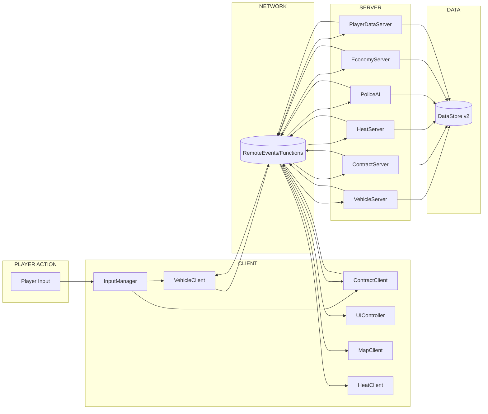
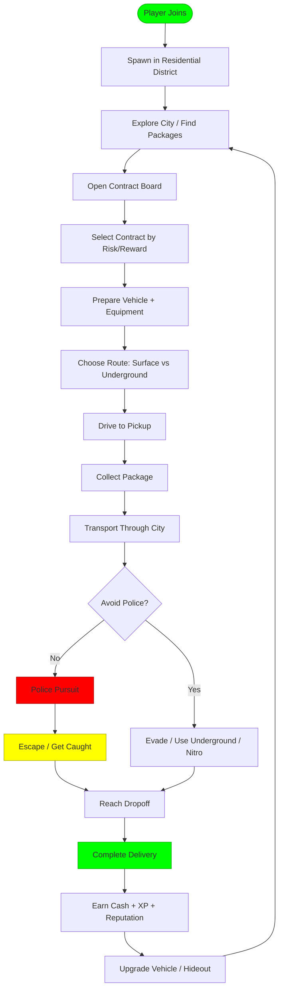
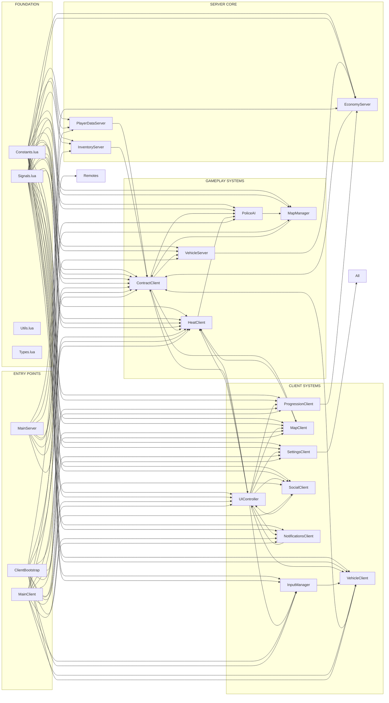
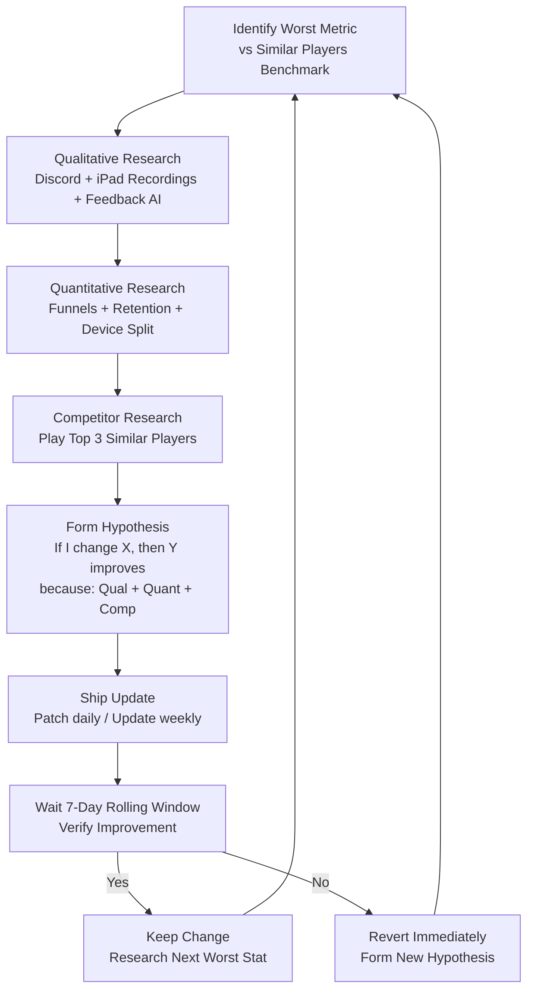
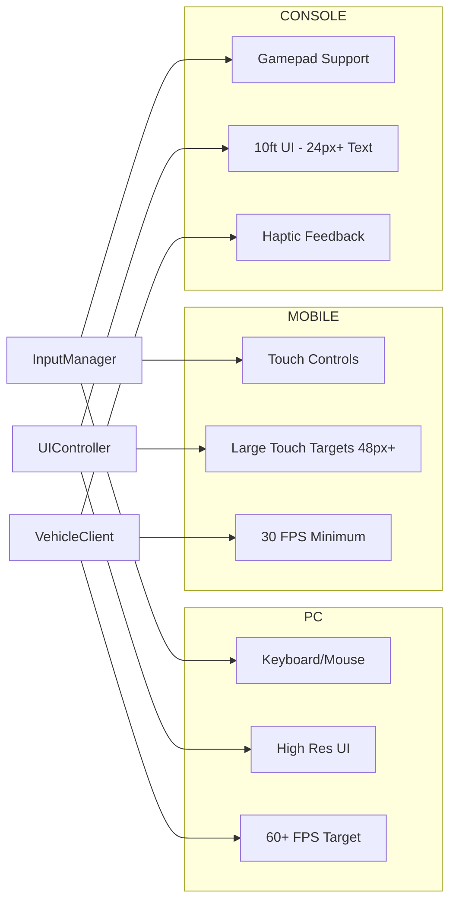

# UNDERGROUND Project Architecture Graph

> Visual representation of the UNDERGROUND Roblox game architecture. Render this in Obsidian with the Mermaid plugin enabled.

---

## 🏗️ High-Level Architecture

```mermaid
graph TB
    subgraph "🎮 GAME CORE"
        GDD[GDD.md<br/>Game Design Doc]
        README[README.md<br/>Setup Guide]
    end

    subgraph "📚 SHARED LIBRARY"
        Constants[Constants.lua<br/>500+ config lines]
        Types[Types.lua<br/>TypeScript defs]
        Utils[Utils.lua<br/>Helpers]
        Signals[Signals.lua<br/>Event System]
    end

    subgraph "🔌 REMOTE DEFINITIONS"
        Remotes[RemoteEvents.lua<br/>50+ Events + 15 Functions]
    end

    subgraph "🖥️ SERVER SYSTEMS"
        PlayerData[PlayerDataServer.lua<br/>DataStore v2 + Session Locking]
        Economy[EconomyServer.lua<br/>Currency + Vehicles + Robux]
        Inventory[InventoryServer.lua<br/>Packages + Garage + Storage]
        Contracts[ContractServer.lua<br/>7 Types + GPS + Competitive]
        Vehicles[VehicleServer.lua<br/>Auth Physics + 25 Models]
        Heat[HeatServer.lua<br/>0-5 Stars + Decay + Thresholds]
        Police[PoliceAI.lua<br/>Patrols + Pursuits + SWAT]
        MapMgr[MapManager.lua<br/>7 Districts + Pathfinding]
    end

    subgraph "🚀 SERVER ENTRY"
        MainServer[MainServer.lua<br/>Init + Cross-System + Admin]
    end

    subgraph "📱 CLIENT SYSTEMS"
        UI[UIController.lua<br/>HUD + Screens + Toasts]
        Input[InputManager.lua<br/>KB/Mouse/Gamepad/Touch]
        Vehicle[VehicleClient.lua<br/>60Hz Physics + Camera]
        Contracts[ContractClient.lua<br/>Board + GPS + Delivery]
        Map[MapClient.lua<br/>Minimap + GPS + Markers]
        Heat[HeatClient.lua<br/>Heat UI + Pursuit Music]
        Progression[ProgressionClient.lua<br/>XP + Levels + Prestige]
        Social[SocialClient.lua<br/>Friends + Party + Leaderboards]
        Notifications[NotificationsClient.lua<br/>Toasts + Achievement Popups]
        Settings[SettingsClient.lua<br/>100+ Settings + Accessibility]
    end

    subgraph "🎯 CLIENT ENTRY"
        MainClient[MainClient.lua<br/>10 Systems Init]
        Bootstrap[ClientBootstrap.lua<br/>Remotes + Signal Setup]
    end

    subgraph "🧠 TIZZY RBLX KNOWLEDGE VAULT"
        VaultIdx[00_INDEX.md<br/>Master MOC]
        Concepts[19 Concepts<br/>Building Blocks, 5 Guarantees...]
        Workflows[7 Workflows<br/>Market Research, MVP, LiveOps...]
        Videos[15 Video Notes<br/>Full transcripts + takeaways]
        Tools[6 Tools<br/>RoTrends, qptr.io, Creator Exchange...]
        Queries[4 Dataview Queries<br/>Auto-grouping]
        Canvases[4 Canvas Files<br/>Visual Diagrams]
    end

    %% Core connections
    GDD --> Constants
    README --> Constants
    Constants --> Remotes
    Constants --> PlayerData
    Constants --> Economy
    Constants --> Inventory
    Constants --> Contracts
    Constants --> Vehicles
    Constants --> Heat
    Constants --> Police
    Constants --> MapMgr
    Constants --> UI
    Constants --> Input
    Constants --> Vehicle
    Constants --> Contracts
    Constants --> Map
    Constants --> Heat
    Constants --> Progression
    Constants --> Social
    Constants --> Notifications
    Constants --> Settings
    
    Signals --> PlayerData
    Signals --> Economy
    Signals --> Inventory
    Signals --> Contracts
    Signals --> Vehicles
    Signals --> Heat
    Signals --> Police
    Signals --> MapMgr
    Signals --> UI
    Signals --> Input
    Signals --> Vehicle
    Signals --> Contracts
    Signals --> Map
    Signals --> Heat
    Signals --> Progression
    Signals --> Social
    Signals --> Notifications
    Signals --> Settings

    Remotes --> PlayerData
    Remotes --> Economy
    Remotes --> Inventory
    Remotes --> Contracts
    Remotes --> Vehicles
    Remotes --> Heat
    Remotes --> Police
    Remotes --> MapMgr
    Remotes --> UI
    Remotes --> Input
    Remotes --> Vehicle
    Remotes --> Contracts
    Remotes --> Map
    Remotes --> Heat
    Remotes --> Progression
    Remotes --> Social
    Remotes --> Notifications
    Remotes --> Settings

    MainServer --> PlayerData
    MainServer --> Economy
    MainServer --> Inventory
    MainServer --> Contracts
    MainServer --> Vehicles
    MainServer --> Heat
    MainServer --> Police
    MainServer --> MapMgr

    MainClient --> UI
    MainClient --> Input
    MainClient --> Vehicle
    MainClient --> Contracts
    MainClient --> Map
    MainClient --> Heat
    MainClient --> Progression
    MainClient --> Social
    MainClient --> Notifications
    MainClient --> Settings

    Bootstrap --> Remotes
    Bootstrap --> UI
    Bootstrap --> Input
    Bootstrap --> Vehicle
    Bootstrap --> Contracts
    Bootstrap --> Map
    Bootstrap --> Heat
    Bootstrap --> Progression
    Bootstrap --> Social
    Bootstrap --> Notifications
    Bootstrap --> Settings

    VaultIdx --> Concepts
    VaultIdx --> Workflows
    VaultIdx --> Videos
    VaultIdx --> Tools
    VaultIdx --> Queries
    VaultIdx --> Canvases

    Concepts --> Workflows
    Workflows --> Videos
    Videos --> Concepts
```

---

## 🔄 Data Flow Diagram

---

## 🎯 Core Gameplay Loop

---

## 📊 System Dependencies

---

## 🎨 Canvas Files (Open in Obsidian)

| Canvas File | Description |
|-------------|-------------|
| `Canvas/Game Design Theory Canvas.canvas` | Visual map of 5 building blocks + 5 guarantees |
| `Canvas/Algorithm Discovery Canvas.canvas` | Farmers market analogy + two markets + beta mode hack |
| `Canvas/Live Ops Cycle Canvas.canvas` | Weekly calendar: Sat launch → Sun plan → Mon-Wed build → Fri test → Sat launch |
| `Canvas/MVP Development Canvas.canvas` | Phase gates: Assets → Programmer → Beta Launch → Iterate |

---

## 📈 Metrics Flow (Scientific Method)

---

## 📱 Platform-Specific Flow

---

## 📋 Usage in Obsidian

1. **Enable Mermaid Plugin**: Settings → Community Plugins → Mermaid → Enable
2. **Open this file** in Obsidian - diagrams will render automatically
3. **Open Canvas files** from the `Canvas/` folder for visual editing
4. **Use Dataview queries** from `Queries/` folder for auto-generated views

---

*Generated for UNDERGROUND Roblox Project | Tizzy RBLX Methodology*